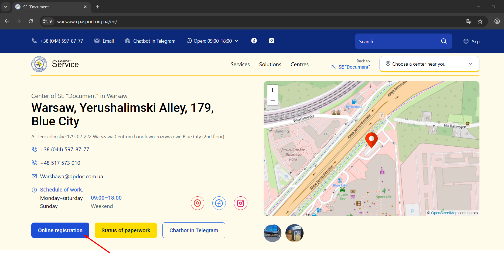
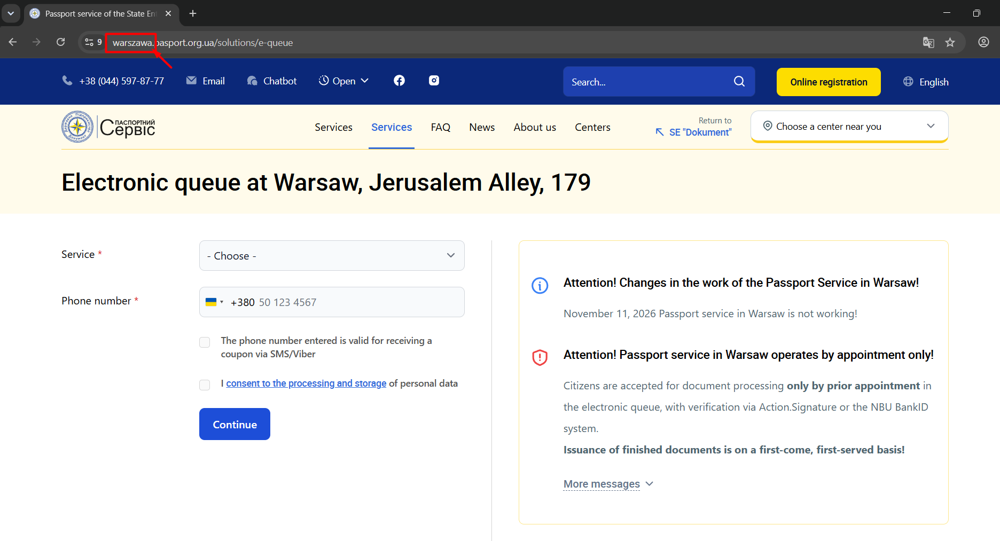

# DP_Document_bot
A Telegram bot for automatically monitoring the availability of slots in the online queue at the DP ‘Dokument’ 
State Enterprise for the reissue of domestic and international passports

The bot checks the availability of appointments on the website of the selected service centre at set intervals and sends
notifications via Telegram when available dates become available.

# Features
- Appointment monitoring — automatic checking of availability.

- Telegram notifications — messages when dates become available.

- Choice of service centre — the ability to check appointment availability across different centres.

- Automatic operation — runs in the background on a Linux server.

- GoLogin — use of the GoLogin browser environment to interact with the website.

- 24/7 operation — ability to start and restart automatically via systemd.

# Used technologies
- Python

- Telegram Bot API

- Aiogram

- SQLite

- GoLogin Orbita Browser

- Ubuntu Linux

- systemd

# How it`s work
1. The bot starts the monitoring cycle.

2. It opens the online booking page for the selected service centre.

3. It retrieves and checks the data on available dates.

4. It determines whether there are any free slots.

5. It sends a notification via Telegram stating the number of available dates and providing a link to the online booking page.

# Installation and running
## Requirements
1. A Linux server or a local environment with Python.

2. The project’s dependencies installed.

3. The Telegram bot’s token.

4. A configured GoLogin Agent Browser environment

    ➡️[Guide to install GoLogin](documents/GoLogin_Setup_Guide.md)

## Installation project
`
git clone <REPOSITORY_URL>
cd DP_Document_bot
`

`
python3 -m venv .venv
source .venv/bin/activate
`

`
python pip install -r requirements.txt
`

# Configuring the environment

Create a .env file containing the following variables:
➡️[.env.exemple](documents/.env.exemple)

1. GOLOGIN_TOKEN – see the GOLOGIN setup guide for details
2. GOLOGIN_PROFILE_ID – see the GOLOGIN setup guide for details 

3. BOT_TOKEN – Telegram bot token

4. SERVICE_CENTRE – instructions provided below
5. CHECK_INTERVAL_MINUTES – set the interval at which requests are made to the Document Service Centre. (Optimal interval: 15 minutes)

Do not publish tokens, passwords or other sensitive information in the repository.

# Guidance on selecting a SERVICE_CENTRE
You should visit the official DP Dokument website for your city. 
For example, if you need a service centre in Warsaw, go to the DP Dokument Warsaw website.
Then click on the ‘Online registration’ button.

Once you have gone to the service selection page, you will need to copy the name of your centre from the link’s address.

In this particular example, we need to copy “warszawa” and paste this value into the .env file under the SERVICE_CENTRE field.
`SERVICE_CENTRE=warszawa`

# Running
To run the project, execute the command from the project directory 
`python main.py`

# Deployment on the server
To run continuously on Ubuntu, the bot can be started as a systemd service.

Useful commands:
```
# Check the status of the service
sudo systemctl status dp-document-bot

# Restart the bot
sudo systemctl restart dp-document-bot

# Stop the bot
sudo systemctl stop dp-document-bot

# Starting the bot
sudo systemctl start dp-document-bot

# View logs in real time
journalctl -u dp-document-bot -f

# View the last 100 lines of the logs
journalctl -u dp-document-bot -n 100 --no-pager
```

# Author
Developed and maintained by AlexeySerebryansky.

Copyright (c) 2026 AlexeySerebryansky.

Licensed under the PolyForm Noncommercial License 1.0.0. See LICENSE for details.
