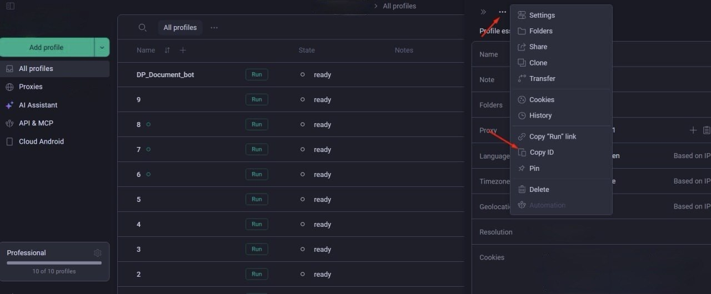

# GoLogin Agent Browser — Installation and Configuration Guide

This guide describes the purpose of GoLogin, how to configure a cloud-based browser profile, how to set up a proxy,
and how to install the GoLogin Agent Browser on Ubuntu Linux for the DP_Document_bot project.

# Contents

[1. What is GoLogin and why do you need it?](#1-what-is-gologin-and-why-do-you-need-it)

[2. Creating a GoLogin account](#2-Creating-a-GoLogin-account)

[3. Creating a cloud profile](#3-Creating-a-cloud-profile)

[4. Configuring the proxy](#4-Configuring-the-proxy)

[5. Obtaining an API token and profile ID](#5-Obtaining-an-API-token-and-profile-ID)

[6. Installing Node.js and npm](#6-Installing-Nodejs-and-npm)

[7. Installing the GoLogin Agent Browser](#7-Installing-the-GoLogin-Agent-Browser)

[8. Configuring environment variables](#8-Configuring-environment-variables)

[9. Testing the connection](#9-Testing-the-connection)

[10. Connecting to the Telegram bot](#10-Connecting-to-the-Telegram-bot)

## 1. What is GoLogin and why do you need it?

**GoLogin** is a service for creating and managing browser profiles, each with its own set
of browser environment settings.

A browser profile may include browser settings, cookies, session data, browser fingerprint parameters
and other characteristics used by websites to analyse visitors.

GoLogin allows you to run browser profiles locally or in the cloud. Our project uses a **cloud-based browser profile**,
which we manage via the GoLogin Agent Browser.

Official website: https://gologin.com/

### Why our bot needs GoLogin

`DP_Document_bot` checks the availability of appointment slots on the DP Dokument website
and sends notifications via Telegram.

The website uses **Cloudflare** security mechanisms, which can analyse various characteristics of the connection
and the browser environment. Depending on the security settings and the specific request,
browser parameters, JavaScript, cookies, network characteristics and other signals may be taken into account.

Therefore, simply sending HTTP requests or launching a standard browser with default settings is not sufficient
to interact with the website. It is important to ensure the browser environment is as consistent and natural-looking
as possible.

**GoLogin is used in our project to emulate the user’s browser environment to the highest possible standard.**

In particular, this allows us to:

- Use a separate browser profile with specified environment settings.
- Manage cookies and session data.
- Configure browser fingerprint settings.
- Perform actions within a fully-fledged browser environment, rather than being limited to direct HTTP requests.
- Use a cloud-based browser infrastructure without having to run a full-featured browser directly on our Ubuntu server.

However, GoLogin does not guarantee that Cloudflare will be bypassed: the result depends on the website’s
security configuration, session status, network environment and other factors.

### What is GoLogin Agent Browser

**GoLogin Agent Browser** is a command-line interface (CLI) tool that allows you to manage browser sessions from within
your code.

In our project, it acts as the link between the Python bot and the GoLogin browser infrastructure.

With its help, the bot can launch and control a browser session, open the necessary pages and perform the actions
specified by the monitoring logic.

Thus, Python is responsible for the business logic of monitoring, processing results and sending notifications, whilst
the Agent Browser handles interaction with the browser environment.

### Why a proxy is needed

A **proxy** is an intermediary server through which the browser’s network traffic passes.

In our project, the proxy is used in conjunction with GoLogin to configure the network environment of the browser
profile. Its role is to provide the selected connection route and the corresponding external IP address.

This is important because the network characteristics of the connection are one of the factors that websites may take
into account when evaluating requests. Therefore, the network environment must be consistent with the other settings of
the browser profile.

The proxy and GoLogin perform different functions:

- **GoLogin** — manages the browser profile and its settings.
- **Agent Browser** — software-based management of the browser session.
- **Proxy** — the network connection route and external IP address.

Using a proxy does not in itself guarantee that a website will be accessible or that Cloudflare checks will be
successfully passed. The outcome depends on a combination of browser, network and current session characteristics.

## 2. Creating a GoLogin account

1. Go to [https://gologin.com/](https://gologin.com/).
2. Create an account or log in to an existing one.
3. Open the GoLogin control panel.
4. Ensure that your account allows you to create cloud browser profiles.
5. Check that you have API access.

If the section names in the interface differ, please refer to the latest GoLogin documentation.

## 3. Creating a cloud profile

A browser profile stores the settings for the environment in which the browser will run.

1. Open the web version of GoLogin in a standard browser, such as Google Chrome.
2. Create a new browser profile.
3. Give it a descriptive name, such as `DP-Document-Bot`.
4. Save the profile.
5. Make sure it appears in the list of profiles.

### An important distinction: the web version and the desktop application

GoLogin offers two ways of working with browser profiles:

- **The GoLogin web version** — when you launch a profile via the web interface, a cloud-based browser is used. It is
  this option that corresponds to our project’s architecture.
- **GoLogin desktop application** — used to launch browser profiles locally on the computer where the application is
  installed.

**The web version of GoLogin is sufficient for configuring our bot.** There is no need to install the desktop
application specifically for this task.

The project uses a cloud-based browser profile, which the bot controls via the GoLogin Agent Browser. The browser itself
runs on the GoLogin side, so there is no need to install and run Orbita directly on our Ubuntu server.

## 4. Configuring the proxy

This project uses residential proxies. These operate using IP addresses associated with home internet connections.

GoLogin offers its own proxies, which can be purchased and used alongside browser profiles. It is also possible to
connect proxies from third-party providers, provided they meet the necessary requirements.

**Important: for our project, you must use residential proxies. Other types of proxy are not suitable for this
configuration.**

### 4.1. Choosing a proxy

There are two options:

- **GoLogin proxies** — these can be purchased directly from GoLogin and configured for a browser profile.
- **Third-party proxies** — you can use a proxy from another provider, provided it offers residential IP addresses and
  the necessary connection details.

**Critically important: the proxy’s country must match the country of the website the bot is interacting with.**

For example:

- **Warsaw, Poland** — use a Polish proxy.
- **Prague, Czech Republic** — use a Czech proxy.
- **Kyiv, Ukraine** — use a Ukrainian proxy.

This requirement stems from the fact that GoLogin’s cloud infrastructure utilises remote servers located in various
European countries. The geographical location of the server from which the browser is launched may differ from the
country of the target website.

To ensure that the network environment matches the website’s region, you must select a resident proxy from the exact
country in which the target service operates.

**Do not select a proxy from a random country.** Before purchasing or configuring a proxy, please ensure that the
provider allows you to select the required country and that the actual external IP address corresponds to the selected
region.

### 4.2. Preparing proxy details

To connect to a third-party proxy, you will need the following details:

- **Name** — any name for the proxy to make it easier to identify.
- **Host** — the IP address or domain name of the proxy server.
- **Port** — the port used to connect to the proxy server.
- **Username** — the username for authentication.
- **Password** — the password for authentication.

The connection type must match the format supported by the provider and accepted by the GoLogin interface.

When selecting a proxy, also ensure that it provides a residential IP address from the required country.

### 4.3. Adding a proxy to a profile

1. Open the web version of GoLogin.
2. Open the settings for the `DP-Document-Bot` profile you have created.
3. Locate the proxy settings section.
4. Choose whether to add your own proxy or connect to a third-party provider.
5. Enter the name, host, port, username and password in the relevant fields.
6. Ensure that the proxy corresponds to the country of the target website.
7. Save the settings.
8. Use the proxy test function, if available in the interface.

If you are using a GoLogin proxy, follow the service’s instructions for purchasing and connecting the proxy to your
profile. When selecting an available region, specify the country of the target website.

Field names and the layout of the settings may vary depending on the interface version.

### 4.4. Checking the connection

Once you have configured the settings, ensure that GoLogin successfully verifies the connection to the proxy.

If necessary, launch a cloud profile and open a website to check the external IP address.

Check that:

- The proxy connects successfully.
- The external IP address corresponds to the selected country.
- The verification page loads without errors.

If the connection is not working, check:

- That the host and port are correct.
- Your username and password.
- The proxy type and its compatibility with GoLogin.
- The proxy status and server availability with your provider.
- That the actual IP address corresponds to the required country.

**Important:** Do not publish your username, password or other confidential proxy details in the project repository or
public documentation.

## 5. Obtaining an API token and profile ID

For Agent Browser to work, it requires data that enables it to access the required profile.

### 5.1. Obtaining an API token

1. Log in to the GoLogin control panel.
2. Open the API management section.
3. Locate the function for creating a token.
4. Create a token if you do not already have a suitable one.
5. Copy it and store it in a safe place.

Current documentation: [https://github.com/GologinLabs/agent-browser](https://github.com/GologinLabs/agent-browser)

The API token is a secret. Do not publish it on GitHub, include it in your README, or send it in public messages.

### 5.2. Obtaining the profile ID

The profile ID is a unique identifier for a browser profile. It is not the profile name or the API token.

Find the profile ID in the GoLogin control panel or use the ‘View Profiles’ command provided by your installed version
of Agent Browser.

Copy the ID exactly as it is: you will need it to configure the bot.



## 6. Installing Node.js and npm

Agent Browser can be distributed as a npm package. Before installing, check which versions of Node.js and npm are
required for the version of the CLI you are using.

Check if Node.js is installed:

`node --version`

Check if npm is installed:

`npm --version`

If the required tools are not installed, install a compatible version of Node.js following the official instructions:

[https://nodejs.org/en/download](https://nodejs.org/en/download)

After installation, run both commands again.

Ensure that Node.js and npm are available to the specific Linux user under whose account the bot is running.

## 7. Installing the GoLogin Agent Browser

Install the Agent Browser in accordance with the project’s current documentation:

[https://github.com/GologinLabs/agent-browser](https://github.com/GologinLabs/agent-browser)

If the version you are using supports installation via npm, the command may look as follows:

`npm install -g gologin-agent-browser-cli`

Before running this, check the current package name and the recommended installation method in the official
documentation.

After installation, check that the command is available:

`gologin-agent-browser --help`

If the command is not found, check where npm places global executables and whether the relevant directory is accessible
via the `PATH` variable.

Do not blindly re-install the package: first ensure that you are using the correct package name and CLI version.

## 8. Configuring environment variables

The `.env` file in the `DP_Document_bot` directory is used to configure the project.

Example configuration:

```
GOLOGIN_TOKEN=your_gologin_api_token
GOLOGIN_PROFILE_ID=your_cloud_profile_id
BOT_TOKEN=your_telegram_bot_token
SERVICE_CENTRE=warszawa
CHECK_INTERVAL_MINUTES=15
```

Replace the examples with your actual values.

| Variable | Purpose |
| ------------------------ | ---------------- ---------------------------- |
| `GOLOGIN_TOKEN`          | GoLogin API token |
| `GOLOGIN_PROFILE_ID`     | Cloud browser profile ID |
| `BOT_TOKEN`              | Telegram bot token |
| `SERVICE_CENTRE`         | Identifier of the selected DP Dokument centre |
| `CHECK_INTERVAL_MINUTES` | Interval between monitoring cycles in minutes |

The example `SERVICE_CENTRE=warszawa` is provided for illustrative purposes only. Use the identifier for your own
centre.

The recommended monitoring interval in the current project configuration is 15 minutes. Please observe the website’s
rules and restrictions.

### Important notes

- Do not include spaces around the `=` sign.
- Do not include actual tokens in the README.
- Do not upload the `.env` file to a public repository.
- Variable names must match exactly those used in the Python code. (See [.env.exemple](.env.exemple))

## 9. Testing the connection

Before launching the bot, ensure that Agent Browser is installed and can work with a cloud profile.

### 9.1. Checking the CLI

Run:

`gologin-agent-browser --help`

If the command is not found, return to the Agent Browser installation section.

### 9.2. Checking the API and profile

Use the command for viewing profiles or checking the connection, as documented for your installed version of Agent
Browser.

Ensure that:

- The API token is valid.
- The profile is accessible to your account.
- You are using the cloud profile.
- The profile has the correct proxy settings.

You must select the correct verification command based on the installed version of the CLI: the syntax for cloud
execution may differ from that for local execution.

### 9.3. Verification via the Python bot

Once the Agent Browser has been successfully verified, run the project and check the application logs.

Ensure that the bot can initiate a browser session, retrieve the page and process the result without errors.

## 10. Connecting to the Telegram bot

Once GoLogin and Agent Browser have been configured:

1. Navigate to the project directory.
2. Activate the Python virtual environment.
3. Ensure that the project’s dependencies are installed.
4. Check the `.env` file.
5. Run the bot using the command specified by the project.

`python3 main.py`

Upon launch, check the application’s output and error logs.

If the bot is run via `systemd`, ensure that the service uses the correct Linux user, working directory, Python
environment and environment variable settings.

The CLI running successfully in an interactive terminal does not guarantee that it will automatically work in `systemd`:
the service environment may differ.
